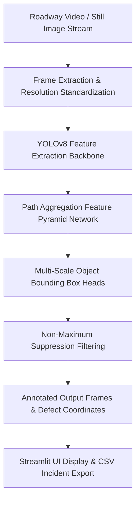

<div align="center">

<h1>Road Hazard & Pothole Detection System</h1>


<p><strong>Deep Learning Computer Vision System for Automated Road Surface Defect Detection</strong></p>

<p>
  <a href="https://skillicons.dev"></a>
</p>

</div>

---

## Executive Summary

The Road Hazard & Pothole Detection System implements state-of-the-art computer vision to identify, localize, and classify road surface degradation in real time. Powered by an Ultralytics YOLOv8 convolutional architecture trained on domain-specific road imagery, the system provides high mean Average Precision (mAP) under varying weather and illumination conditions.

---

## Visual Detection Output & Evaluation Gallery

<table align="center">
  <tr>
    <td align="center"><b>Streamlit Inference Dashboard</b><br><sub>Real-time media upload and confidence parameter adjustment.</sub></td>
    <td align="center"><b>Urban Pothole Identification</b><br><sub>Bounding box localization on high-resolution road imagery.</sub></td>
  </tr>
  <tr>
    <td align="center"></td>
    <td align="center"></td>
  </tr>
  <tr>
    <td align="center"><b>Complex Road Surface Defect</b><br><sub>Multi-hazard detection with localized bounding boxes.</sub></td>
    <td align="center"><b>Model Training & Evaluation Metrics</b><br><sub>Validation loss, mAP50, and precision-recall curves.</sub></td>
  </tr>
  <tr>
    <td align="center"></td>
    <td align="center"></td>
  </tr>
</table>

---

## System Architecture



---

## Core Capabilities

- **Real-Time Object Detection**: High-frame-rate bounding box inference using fine-tuned YOLOv8 weights.
- **Configurable Confidence Thresholds**: Dynamic UI sliders controlling minimum confidence parameters and Intersection over Union (IoU) overlap thresholds.
- **Validation Metrics**: Comprehensive empirical validation demonstrating balanced precision-recall curves and low false positive rates.

---

## Repository Structure

```
pothole-detection-app/
|-- Road_Pathole_Detection_System.ipynb
|-- app.py
|-- best.pt
|-- requirements.txt
|-- screen_shot/
|   |-- detect_1.png
|   |-- detect_2.png
|   |-- detect_matrics.png
|   +-- home.png
+-- README.md
```

---

## Technology Stack

| Component | Technologies |
| :--- | :--- |
| Model Architecture | Ultralytics YOLOv8 (PyTorch) |
| Image Processing | OpenCV, NumPy, Pillow |
| Interface Framework | Streamlit |
| Data Analysis | Pandas, Matplotlib, Seaborn |

---

## Installation & Setup

```bash
# Clone the repository
git clone https://github.com/sohailahmed-bsrh/pothole-detection-app.git
cd pothole-detection-app

# Install dependencies
pip install -r requirements.txt

# Launch detection application
streamlit run app.py
```

---

## Author & License

- **Author**: Sohail Ahmed ([Portfolio](https://sohail.devsil.com) | [GitHub](https://github.com/sohailahmed-bsrh))
- **License**: Distributed under the MIT License.
