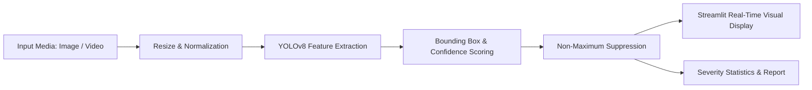

# Road Surface Hazard Detection System

> Computer vision detection framework powered by YOLOv8 for automated road condition assessment.

[](https://github.com/sohailahmed-bsrh/pothole-detection-app)
[](https://sohail.devsil.com/projects.html)
[](https://sohail.devsil.com)

---

## Overview

Municipal road maintenance relies heavily on delayed citizen complaints, resulting in hazardous road conditions, infrastructure decay, and vehicle damage.

This project provides an end-to-end, reproducible implementation engineered to solve this challenge through verified data transformations, robust algorithms, and production-ready architecture.

---

## Key Features

- Deep learning object detection utilizing the YOLOv8 single-stage detector
- Inference pipeline capable of processing high-resolution static images and continuous video feeds
- Interactive Streamlit web dashboard for confidence threshold tuning and visual bounding box inspection
- Automated hazard count aggregation and severity assessment metrics

---

## System Architecture



---

## Technology Stack

| Technology | Version / Spec | Role in Architecture |
| :--- | :--- | :--- |
| **Ultralytics YOLOv8** | `8.0+` | Object detection architecture trained on asphalt distress patterns |
| **PyTorch** | `2.0+` | Tensor execution runtime and GPU acceleration |
| **OpenCV** | `4.8+` | Video frame decoding, transformation, and visual overlay |
| **Streamlit** | `1.28+` | Interactive web interface for inference demonstration |

---

## Repository Structure

```text
pothole-detection-app/
|-- app.py
|-- Road_Pathole_Detection_System.ipynb
|-- models/
|   `-- best.pt
|-- data/
|-- src/
|-- .gitignore
|-- requirements.txt
`-- README.md
```

---

## Installation and Execution

### Prerequisites
- Python 3.10 or higher
- Git version control
- Virtual environment manager (`venv`)

### Setup Instructions
1. Clone the repository:
```bash
git clone https://github.com/sohailahmed-bsrh/pothole-detection-app.git
cd pothole-detection-app
```

2. Configure environment and dependencies:
```bash
python -m venv venv
source venv/bin/activate  # On Windows: venv\Scripts\activate
pip install -r requirements.txt
streamlit run app.py
```

---

## Interface and Verification
The system produces verifiable execution logs, prediction matrices, or interactive browser interfaces depending on the target mode. Verify operation by executing the commands specified above or inspecting the demonstration notebooks.

---

## Author and Contact
Developed by **Sohail Ahmed** — Full Stack AI Engineer & Machine Learning Specialist.
- **Portfolio:** [sohail.devsil.com](https://sohail.devsil.com)
- **GitHub:** [@sohailahmed-bsrh](https://github.com/sohailahmed-bsrh)
- **Email:** [sohail.bsrh@gmail.com](mailto:sohail.bsrh@gmail.com)
