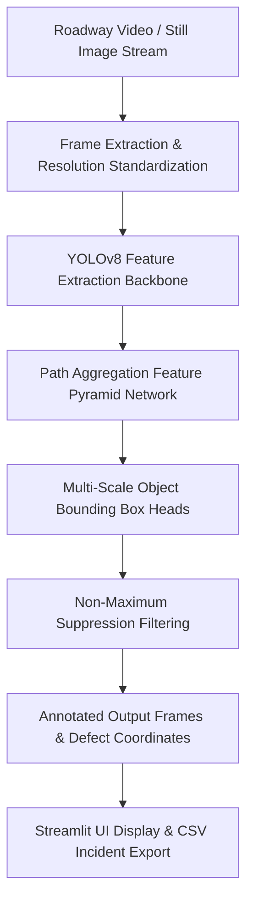

<div align="center">

<h1>Road Hazard & Pothole Detection System</h1>


<p><strong>Deep Learning Computer Vision System for Automated Road Surface Defect Detection</strong></p>

<p>
  <a href="https://skillicons.dev"></a>
</p>

<p>
  <a href="#overview">Overview</a> &bull;
  <a href="#system-architecture">Architecture</a> &bull;
  <a href="#visual-showcase-gallery">Visual Gallery</a> &bull;
  <a href="#core-capabilities">Capabilities</a> &bull;
  <a href="#installation--setup">Installation</a> &bull;
  <a href="#author--contact-information">Author</a>
</p>

</div>

---
## Overview

The Road Hazard & Pothole Detection System implements computer vision to identify, localize, and classify road surface degradation in real time. Powered by an Ultralytics YOLOv8 convolutional architecture trained on domain-specific road imagery, the system provides high mean Average Precision (mAP) under varying weather and illumination conditions.

---

## Visual Showcase Gallery

<table width="100%" align="center">
  <tr>
    <td width="50%" align="center"><b>Streamlit Inference Dashboard</b><br><sub>Real-time media upload and confidence parameter adjustment.</sub></td>
    <td width="50%" align="center"><b>Urban Pothole Identification</b><br><sub>Bounding box localization on high-resolution road imagery.</sub></td>
  </tr>
  <tr>
    <td align="center"></td>
    <td align="center"></td>
  </tr>
  <tr>
    <td width="50%" align="center"><b>Complex Road Surface Defect</b><br><sub>Multi-hazard detection with localized bounding boxes.</sub></td>
    <td width="50%" align="center"><b>Deep Asphalt Fracture Detection</b><br><sub>High-confidence localization under direct sunlight.</sub></td>
  </tr>
  <tr>
    <td align="center"></td>
    <td align="center"></td>
  </tr>
  <tr>
    <td width="50%" align="center"><b>Multiple Hazard Cluster</b><br><sub>Simultaneous tracking of closely grouped surface fractures.</sub></td>
    <td width="50%" align="center"><b>Model Training Metrics Overview</b><br><sub>Training and validation loss across convolutional epochs.</sub></td>
  </tr>
  <tr>
    <td align="center"></td>
    <td align="center"></td>
  </tr>
  <tr>
    <td width="50%" align="center"><b>Precision-Recall Curve</b><br><sub>Validation curve demonstrating high precision at optimal IoU.</sub></td>
    <td width="50%" align="center"><b>Final Model Training Evaluation</b><br><sub>Convergence trajectory of bounding box loss functions.</sub></td>
  </tr>
  <tr>
    <td align="center"></td>
    <td align="center"></td>
  </tr>
  <tr>
    <td width="50%" align="center"><b>Final Evaluation Metric Analysis</b><br><sub>mAP50 and mAP50-95 quantitative evaluation benchmarks.</sub></td>
    <td width="50%" align="center"><b>Last Training Epoch Diagnostics</b><br><sub>Finalized weight parameter performance logs.</sub></td>
  </tr>
  <tr>
    <td align="center"></td>
    <td align="center"></td>
  </tr>
  <tr>
    <td width="50%" align="center"><b>Comprehensive Performance Summary</b><br><sub>Aggregated validation statistics and confusion matrix overview.</sub></td>
    <td width="50%" align="center"><b>Final Metric Verification Table</b><br><sub>Tabular benchmark across testing split samples.</sub></td>
  </tr>
  <tr>
    <td align="center"></td>
    <td align="center"></td>
  </tr>
</table>

---

## System Architecture



---

## Technology Stack

| Component | Technologies |
| :--- | :--- |
| Model Architecture | Ultralytics YOLOv8 (PyTorch) |
| Image Processing | OpenCV, NumPy, Pillow |
| Interface Framework | Streamlit |
| Data Analysis | Pandas, Matplotlib, Seaborn |

---

## Installation & Setup

```bash
# Clone the repository
git clone https://github.com/sohailahmed-bsrh/pothole-detection-app.git
cd pothole-detection-app

# Install dependencies
pip install -r requirements.txt

# Launch detection application
streamlit run app.py
```
---

## Author & Contact Information

<table width="100%" align="center">
  <tr>
    <td align="center" style="padding: 20px;">
      <h3>Sohail Ahmed</h3>
      <p><strong>Full-Stack Artificial Intelligence & Computer Vision Engineer</strong></p>
      <p>
        <a href="https://sohail.devsil.com"></a>
        <a href="https://github.com/sohailahmed-bsrh"></a>
        <a href="https://linkedin.com/in/sohail-ahmed-dev"></a>
        <a href="mailto:sohail.bsrh@gmail.com"></a>
      </p>
      <p><em>Available for technical roles in Artificial Intelligence, Computer Vision, and Full-Stack Engineering.</em></p>
      <hr style="border: 0; height: 1px; background: #30363d; margin: 15px 0;">
      <small>Repository: <code>sohailahmed-bsrh/pothole-detection-app</code> &bull; Distributed under the MIT License.</small>
    </td>
  </tr>
</table>
